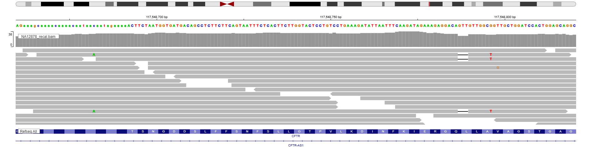
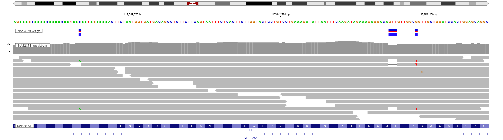
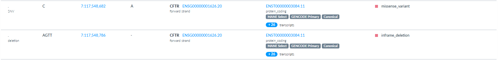
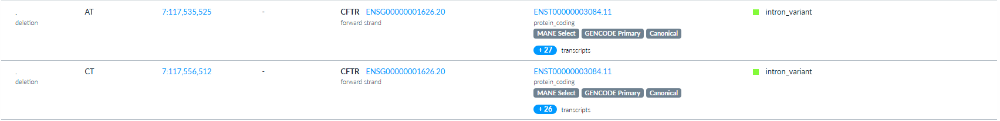

# Variant Detection with GATK (Genome Analysis Toolkit) pipeline. #

## Objective: Analysis of a genome sequencing data issued from WGS and truncated for a more technically manageable data with the aim to identify possible pathological variants in an individual.

**Created as part of the HackBio internship Genome Data Science (Fundamentals)**

> **Data: 1000 Genomes Project (NA12878, 30X WGS); reference files: Broad Institute hg38 resource bundle**

### Files required for analysis:

* Human Reference Genome (`/data/ref/Homo_sapiens_assembly38.fasta`)
* Human reference genome index (`/data/ref/Homo_sapiens_assembly38.fasta.fai`)
* Known sites on the human genome (`/data/ref/Homo_sapiens_assembly38.known_indels.vcf.gz`)
* Sample Genome (`/data/NA12878.fastq.gz`)
* Genome index files (`/data/ref/`)

--------------------------------------------------------------------

## Task

* Analyse eukaryotic human WGS data (already used for analysis) including steps: 
  * Quality Control (QC);
  * Trimming;
  * Alignment;
  * Sorting and Marking Duplicates;
  * Base Quality Score Recalibration (BQSR);
  * Variant Calling;
  * Genotyping;
  * Filtering;
  * Annotation.
* Apply GATK workflow after the alignment step of the analysis. 
* Search for possible pathological variants.

---------------------------------------------------------------------------

## Repository structure

```bash
Genome_Data_Science_HackBio/
├── README.md
└── Stage1_WGS/
    ├── README.md
    └── GATK_training
         ├── README.md
         ├── data/
         ├── images/
         ├── results/
         ├── 00_setup_references.sh
         ├── 01_get_data.sh
         ├── 02_pipeline.sh
         └── .gitignore   # excludes large files (FASTQ, BAM, CRAM)
 ```

------------------------------------------------------------------------

## Technical Details

For technical reasons (end of access to initial files and work from the personal Cloud Shell Google account), additional pre-analytical work was required.

Scripts were run from a working directory in Google Cloud Shell; large files were kept outside the repository.

### 1. Setup reference data for analysis.

* Find an open source database with human sequenced data.
* Truncate and download files with reference genome data.
* Download files with index data for alignment and annotation steps.

### 2. Setup sample data for analysis. 

* Download family file and record the sample of interest (only child was analysed).
* Find the index file required for analysis.
* Truncate and download files to leave only a region where data of analysis interest was located.
* Sort reads by names to pair them properly.
* Reads were converted to FASTQ with `samtools fastq` (equivalent to `gatk SamToFastq`).
* Pair-end reads were used for analysis, so there were two analysed sample files.

### 3. WGS data analysis with GATK framework.

* ***Quality Control:*** 

This step was performed as a required part of NGS data analysis using `fastqc` tool. 
Both reads had warning flags for "Per tile sequencing quality" and for "Per sequence GC content" modules. 
These warning flags can be explained by truncation during the sample preparation stage.
There were no fail flags for any module. 
Phred score for all bases was at the level of 30 because the data underwent trimming in the previous analysis.

* ***Trimming:***

Trimming was included as an additional QC step. 
GATK Best Practices consider it optional, since BWA-MEM soft-clips residual adapter sequence.

* ***Alignment:***

Alignment step was performed in one command using `bwa mem` tool which includes repairing, indexing, alignment and `.sam` file compression to `.bam`.
For alignment step, chromosome 7 CFTR region was extracted from ChGR38 reference genome.

* ***Sorting and Marking Duplicates:***

From this step, GATK framework was applied.
Using `gatk SortSam` tool, possible dulplicates were sorted and indexed based on the genomic coordinates indexing at the alignment step.
Using `gatk MarkDuplicates` tool, duplicates were marked and put in a separate folder, then indexed using `BuildBamIndex` tool.

* ***BQSR:***

Before variant calling base quality score recalibration was performed. 
The quality of bases was now evaluated based in the alignment results, not on the technical accuracy.
First, `gatk BaseRecalibrator` tool created a table of mismatches.
Then, `gatk ApplyBQSR` tool treated the reads based on that table and saved the matching aligned regions.

***Observing recalibrated reads in IGV tool:***

*files:* BQSR/NA12878_recal.bam, BQSR/NA12878_recal.bai

*genome:* hg38; chr7:117,548,660-117,548,820

*image:* 

Aligned recalibrated reads:



* ***Variant Calling:***

File issued from the BQSR step was called for variants using `gatk HaplotypeCaller` tool. 
Recalibrated reads were called for variants based on the reference genome.

***Observing recalibrated reads with variant calls in IGV tool:***

*files:* BQSR/NA12878_recal.bam, BQSR/NA12878_recal.bai, VCF/NA12878.vcf.gz, VCF/NA12878.vcf.gz.tbi

*genome:* hg38; chr7:117,548,660-117,548,820

*image:* 

Aligned recalibrated reads with called variants:



* ***Genotyping:***

Using `gatk GenotypeGVCFs`, the final VCF file was obtained. 
The VCF file contains characteristics of all variants issued from analysis of the sample reads.
Based on these characteristics, variants can be filtered for the final annotation step.

***Observing called variants after genotyping and before filtering in VEP:***

*files:* NA12878.vcf

*genome:* GRCh38.p14

*image:* 

Pathologic predicted molecular consequences are present:



* ***Filtering:***

Three tools were used for variant filtration.
`gatk VariantFiltration` set thresholds for parameters to filter reads with the highest depth, read quality confidence, lowest strand bias (paired-end sample) and the highest mapping quality.
`bcftools filter` filter the reads based on the thresholds established in `gatk VariantFiltration` tool.
`bcftools view` creates a file which contains the final input for VEP.

***Observing called variants after genotyping and after filtering in VEP:***

*files:* NA12878.pass.vcf

*genome:* GRCh38.p14

*image:* 

No pathologic predicted molecular consequences are identified:



* ***Annotation:***

At this stage no code was used.
The annotation stage was performed using Ensembl Variant Effect Predictor (VEP) online tool. 
Before filtering, two pathological variants were discovered in VEP. 
However, after filtering there were no pathological variants detected.
The pathological variants discovered before filtering are more likely artefacts left after sample data preparation.


